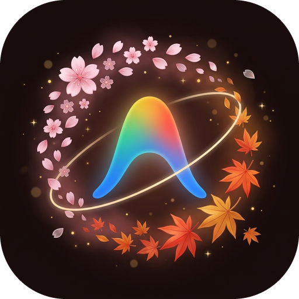
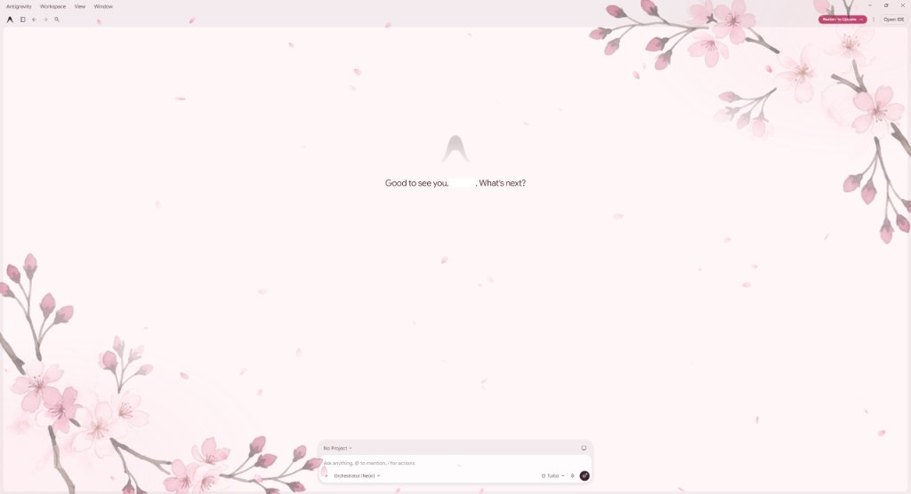
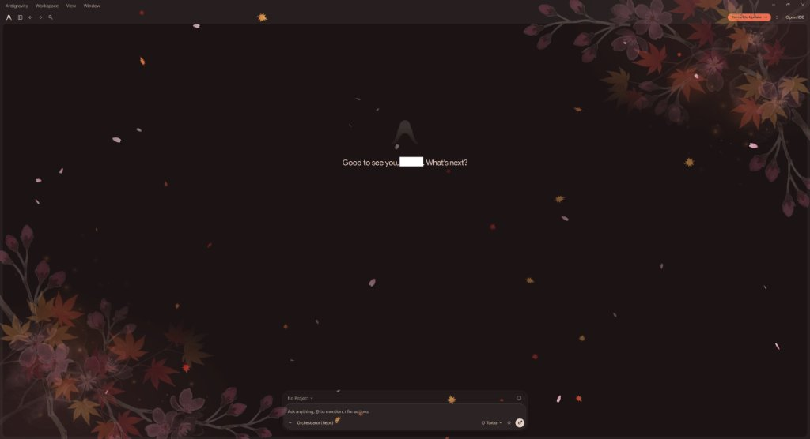

[繁體中文](./README.tw.md) | **English**

# Antigravity Sakura 🌸 & Maple 🍁 Theme

  

A dual-theme visual pack (**Sakura 🌸** & **Maple 🍁**) crafted for the **Antigravity Desktop App (Antigravity 2.0)**. Built with a **non-invasive** design, it compiles the overlay executable locally using Windows' built-in tools and can be restored anytime with a single click.

---

- **Dual Day/Night Theme**
  - **Light Mode — Spring Sakura 🌸 (Sakura)**: Soft cherry-blossom petal white paired with deep yaezakura rose tones.
  - **Dark Mode — Autumn Maple 🍁 (Maple / Momiji)**: Deep roasted-chestnut charcoal paired with Kyoto maple vermilion-orange tones.
- **Sakura × Maple App Icon Preserving the Original Antigravity Logo**
  - Surrounds the original Antigravity emblem with cherry-blossom petals, maple leaves, and a golden orbital ring, automatically applied to Desktop and Start Menu shortcuts.
- **Corner Botanical Framing**
  - Translucent gradient sakura or maple branches softly accent the top-right and bottom-left corners of the window.
- **Syncs with Antigravity Light/Dark Switching**
  - Automatically switches between Sakura and Maple effects whenever the application changes between light and dark modes.
---

## 📸 Preview

| Light Mode — Spring Sakura 🌸 | Dark Mode — Autumn Maple & Mixed 🍁🌸 |
| :---: | :---: |
|  |  |

---

## 🎨 Color Palette

| Key | Dark Mode: Maple 🍁 (Dark) | Light Mode: Sakura 🌸 (Light) |
| :--- | :--- | :--- |
| `background` | `#1C1414` | `#FFF6F8` |
| `primary` | `#EA6C4D` | `#BE3E6B` |
| `foregroundOverride` | `#E5D3C8` | `#3A222A` |
| `primaryForegroundOverride` | `#1C1414` | `#FFF9FB` |
| `codeForegroundOverride` | `#F3AE6D` | `#982E55` |

---

## 💻 System Requirements

- **Windows 10 / Windows 11**
- **[Antigravity App](https://antigravity.google/download?os=windows)**

---

## 🚀 Quick Start

1. Download the latest ZIP from **[Releases](https://github.com/Evan-1230/Antigravity-App-Sakura-Maple-Theme/releases)** (or click **`Code` → `Download ZIP`**) and extract it to any folder.
2. Double-click **`Install_theme.bat`** in the root folder.
3. Choose your preferred default theme mode when prompted (press `Enter` for **Light Sakura** by default, or choose Dark Maple, System Inherit, or Keep current).
4. Wait a few seconds for local compilation and configuration to finish; the overlay effect will launch automatically.
5. If Antigravity is already open and colors haven't updated yet, press **`Ctrl + R`** inside the Antigravity window to reload the UI, or **restart the application**.
6. **Switching Day/Night Modes**: Open **`Settings`** in Antigravity, select **`Appearance`**, and under **`Theme`** freely switch between **Dark (Maple 🍁)** and **Light (Sakura 🌸)**.

> [!TIP]
> If the Desktop or Start Menu icon hasn't refreshed right away, reopen the folder or unpin and re-pin the taskbar shortcut to see the new `Sakura × Maple` icon.

---

## 🖱️ Bottom-Right Taskbar Menu Controls

Once launched, an icon appears in the bottom-right Windows taskbar under `∧`. **Double-click the icon** to quickly pause or resume effects, or **right-click** to configure:

- **Season Mode**: Auto-follow Antigravity Theme / Maple Mode 🍁 / Sakura Mode 🌸 / Mixed Sakura & Maple 🌸🍁
- **Corner Botanical Backdrop**: Off / Subtle (55%) / Vivid (85%)
- **Falling Leaf / Petal Density**: Off / Sparse / Medium / Flurry
- **Pause Effects**
- **Language (Language / 語言)**: 繁體中文 / English
- **Run at Windows Startup** (off by default; can be toggled on manually)
- **Open Theme Folder** / **Exit**

---

## 🧹 One-Click Restore

To remove the theme and restore your previous setup, double-click **`Uninstall_default.bat`** (or `%LOCALAPPDATA%\AntigravitySakuraMapleTheme\Uninstall_default.bat`).

**Auto-Restore**:
- Automatically restores your original Desktop and Start Menu shortcut icons, and removes any startup entry (if enabled) and installed theme files.
- After restoring, press **`Ctrl + R`** inside the Antigravity window to return to a clean backdrop (color settings are kept and can be changed under **`Appearance`**).

---

## 🍎 macOS / 🐧 Linux Users

Open this project using Antigravity's `Browser` feature and just ask **Gemini** to build it for you 🙃

---

## 🔒 License & Notices

- **License**: Source code, scripts, documentation, and original botanical overlay artwork are licensed under the [MIT License](./LICENSE). See [NOTICE.md](./NOTICE.md) for third-party trademark details.
- **Risk Notice**: This pack never modifies any files in the official installation directory and does not affect `Antigravity` automatic updates.
- **Trademark Notice**: The emblem preserved at the center of the App Icon is a trademark and brand mark of `Google / Antigravity`; this theme pack is intended solely for personal use and free, non-commercial community sharing.

> Commercial use is permitted if you replace the App Icon with your own.
