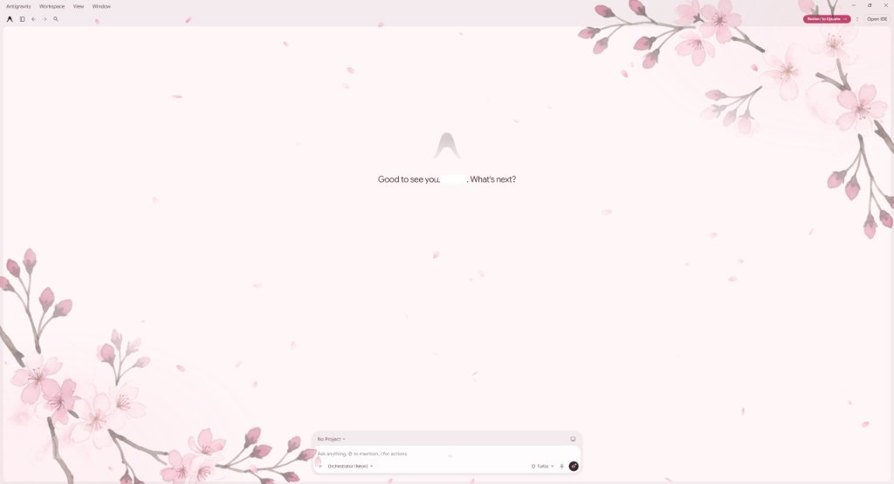
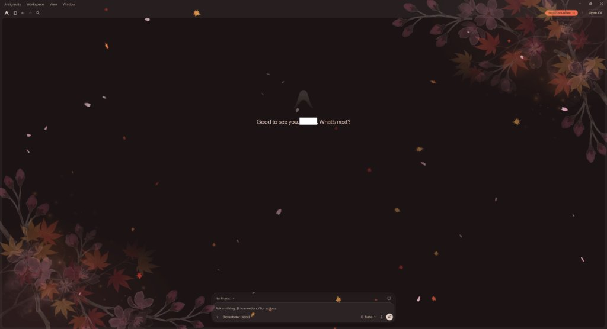

**繁體中文** | [English](./README.md)

# Antigravity 櫻花 🌸 & 楓葉 🍁 主題

  

為 **Antigravity 桌面版（Antigravity 2.0）** 打造的「櫻花 × 楓葉」日夜雙主題視覺套件。採用**非侵入式**設計，透過 Windows 內建工具於本機即時編譯執行檔，可隨時一鍵還原。

---

- **日夜雙主題**
  - **淺色模式 — 春櫻 🌸（Sakura）**：柔白櫻瓣底色搭配八重櫻深粉色調。
  - **深色模式 — 秋楓 🍁（Maple / Momiji）**：深焙栗炭底色搭配京都楓紅橘色調。
- **保留 Antigravity 原版的櫻花 × 楓葉 App Icon**
  - 在原版基礎外圍環繞粉櫻花瓣、楓葉與金色軌道光環，自動套用至桌面與開始功能表捷徑。
- **角落花枝背景裝飾**
  - 在視窗右上與左下角點綴透明漸層的櫻花或楓葉枝枒。
- **同步 Antigravity 深淺切換**
  - 跟隨應用程式切換深／淺模式時自動切換櫻花／楓葉特效。
---

## 📸 實際畫面預覽

| 淺色模式 — 春櫻 🌸（Light Mode） | 深色模式 — 秋楓 × 櫻楓共舞 🍁🌸（Dark / Mixed） |
| :---: | :---: |
|  |  |

---

## 🎨 主題色碼一覽

| 欄位名稱 | 深色模式：楓葉 🍁（Dark） | 淺色模式：櫻花 🌸（Light） |
| :--- | :--- | :--- |
| `background`（背景底色） | `#1C1414` | `#FFF6F8` |
| `primary`（主要強調色） | `#EA6C4D` | `#BE3E6B` |
| `foregroundOverride`（內文文字） | `#E5D3C8` | `#3A222A` |
| `primaryForegroundOverride`（主按鈕文字） | `#1C1414` | `#FFF9FB` |
| `codeForegroundOverride`（程式碼文字） | `#F3AE6D` | `#982E55` |

---

## 💻 系統需求

- **Windows 10 / Windows 11**
- **[Antigravity App](https://antigravity.google/download?os=windows)**

---

## 🚀 快速開始

1. 前往 **[Releases](https://github.com/Evan-1230/Antigravity-App-Sakura-Maple-Theme/releases)** 下載最新 ZIP 檔（或點擊右上角 **`Code` → `Download ZIP`**）並解壓縮至任意資料夾。
2. 雙擊執行根目錄的 **`Install_theme.bat`**。
3. 依畫面提示選擇預設主題模式（直接按 `Enter` 預設為**淺色櫻花**；亦可選擇深色楓葉、跟隨系統或保持現狀）。
4. 等待數秒完成本機編譯與設定套用後，浮層特效將自動啟動。
5. 若 Antigravity 目前已開啟且配色尚未更新，請在 Antigravity 視窗內按 **`Ctrl + R`** 重新載入介面或**重新啟動應用程式**。
6. **日夜切換**：在 Antigravity 中開啟 **`Settings`** 選擇 **`Appearance`**，在 **`Theme`** 即可自由切換 **Dark（楓葉 🍁）** 與 **Light（櫻花 🌸）**。

> [!TIP]
> 若桌面或開始功能表圖示未立即刷新，重新開啟資料夾或取消工作列釘選後再重新釘選即可看到新版 `櫻花×楓葉` 圖示。

---

## 🖱️ 右下角工作列選單功能

啟動後會在 Windows 右下角工作列 `∧` 顯示圖示，**雙擊圖示**可快速暫停／恢復特效，**按右鍵**可設定：

- **季節模式**：自動跟隨 Antigravity 主題 ／ 楓葉模式 🍁 ／ 櫻花模式 🌸 ／ 櫻楓共舞 🌸🍁（混合飄落）
- **背景花枝裝飾**：關閉 ／ 淡雅 (55%) ／ 鮮明 (85%)
- **落葉／落花密度**：關閉 ／ 稀疏 ／ 適中 ／ 紛飛
- **暫停特效**
- **語言切換（語言 / Language）**：繁體中文 ／ English
- **開機時自動啟動**（預設關閉，可自行勾選）
- **開啟主題資料夾** ／ **結束**

---

## 🧹 一鍵完整還原

若想移除主題並恢復安裝前的樣子，直接雙擊執行 **`Uninstall_default.bat`**（或 `%LOCALAPPDATA%\AntigravitySakuraMapleTheme\Uninstall_default.bat`）。

**自動復原**：
- 自動還原桌面與開始功能表原始捷徑圖示，並移除開機自動啟動項（若有啟用）與安裝檔案。
- 還原後在 Antigravity 視窗內按 **`Ctrl + R`** 即可恢復乾淨背景（色碼設定會保留，可回到 **`Appearance`** 介面更改）。

---

## 🍎 macOS / 🐧 Linux 使用者

在 Antigravity 使用 `Browser` 功能開啟本專案，然後直接請 **Gemini** 幫你做吧🙃

---

## 🔒 授權與聲明
- **開源授權**：程式碼、腳本與原創花枝素材依 [MIT License](./LICENSE) 授權；詳細第三方商標區分請參閱 [NOTICE.md](./NOTICE.md)。
- **風險聲明**：本套件不更動官方安裝目錄中的任何檔案，不影響 `Antigravity` 自動更新。
- **商標聲明**：App Icon 中央所保留之標誌屬 `Google / Antigravity` 原有商標與識別設計；本主題套件僅供個人與社群免費非商業交流使用。

> 自行更改 App Icon 後可提供商用
